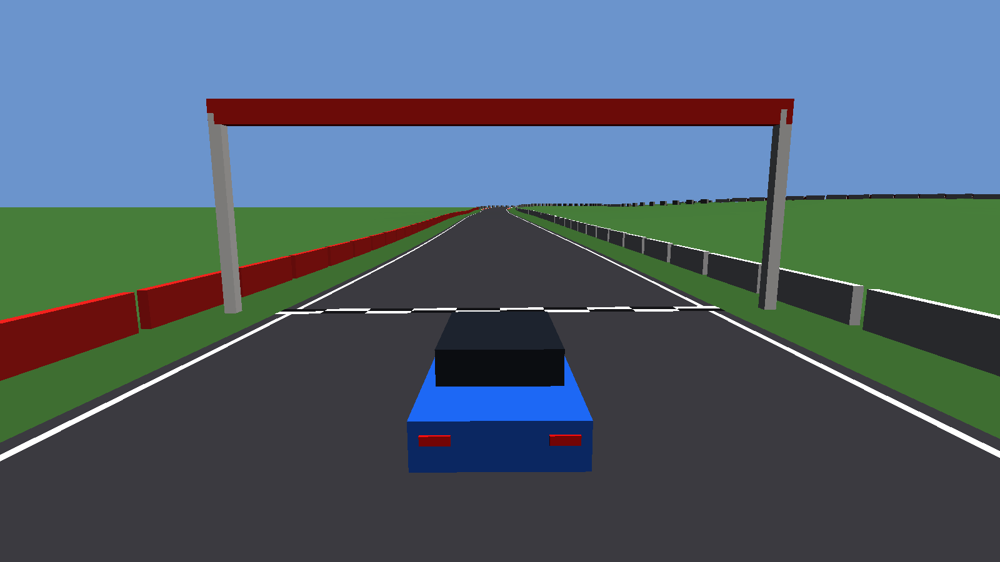
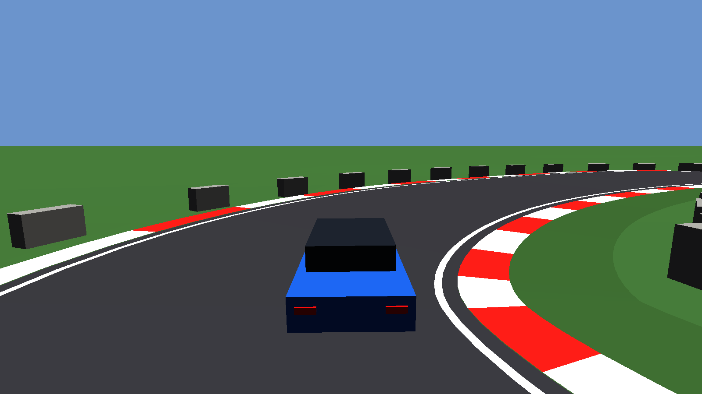
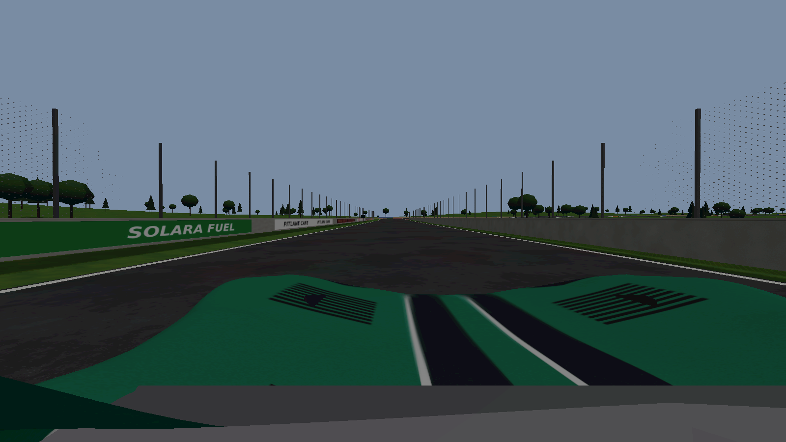
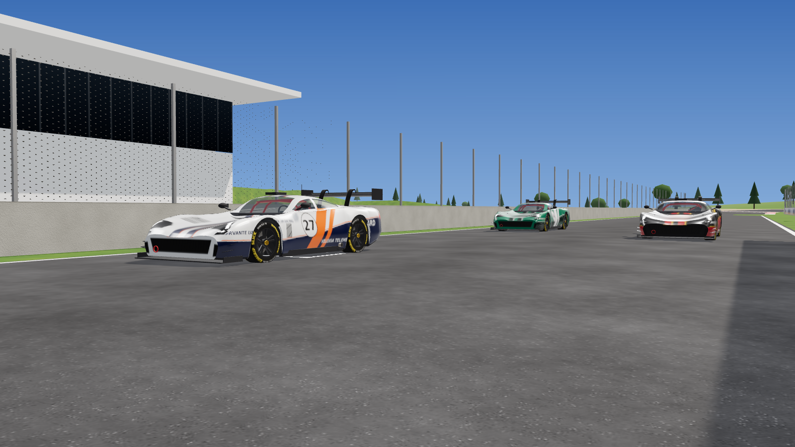
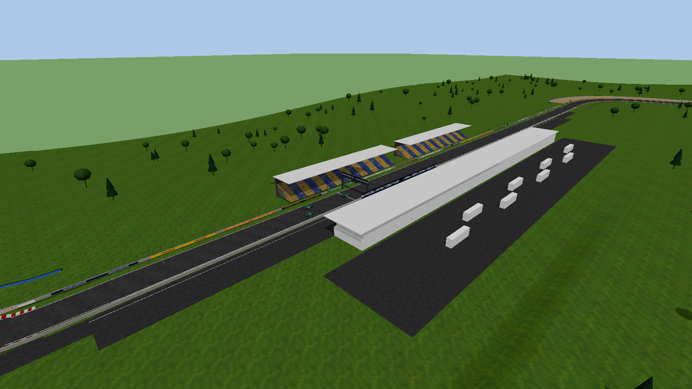
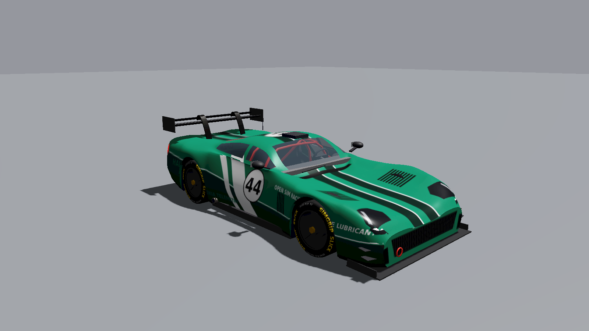
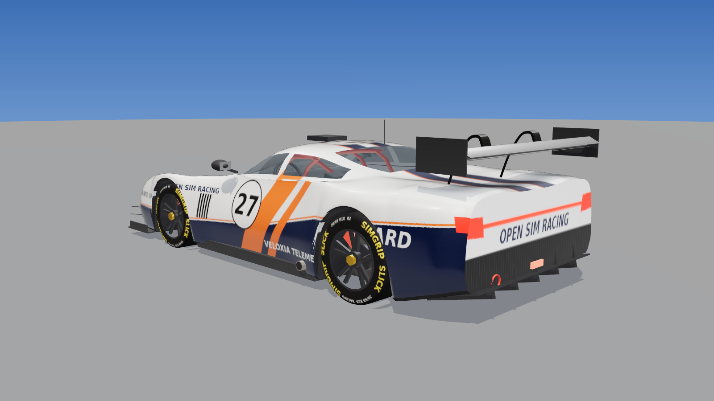

<div align="center">

# Car Simulator

**An open-source driving simulator where the physics come first.**<br>
Its own physics engine. Its own Vulkan renderer. Cars, karts and tracks defined as data, and mods you can write in an afternoon.

[](https://github.com/JesusRB05/Car-simulator/actions/workflows/ci.yml)
[](LICENSE)
[](content/base/LICENSE.txt)


[](docs/CONTRIBUTING.md)

[Build it](#build-and-run-windows) · [Drive it](#controls) · [Mod it](#modding) · [**Help build it**](#get-involved)



</div>

## Why this project

Most open-source racing games borrow a general-purpose physics engine and tune
the handling until it feels right. Car Simulator goes the other way: a
**double-precision, deterministic, fixed 1 kHz physics engine** underneath a
vehicle model built from real equations (Pacejka tyres, double-wishbone
kinematics, a full driveline), and every model comes with a test that checks it
against an analytic solution or a driving manoeuvre.

- **Realism you can verify.** Over 270 tests, with tolerances that are never relaxed to hide a regression.
- **No black boxes.** No Jolt, Bullet, PhysX, bgfx, Diligent or Filament: the physics and the renderer are in this repository and written to be read.
- **Everything is data.** Cars, tracks, skins and tuning are TOML/JSON; scripts are sandboxed Lua; native plugins use a versioned C API.
- **Open and free.** GPL code, CC BY-SA content, no telemetry and no network connections.
- **Early enough to matter.** The architecture is settled and the list of things to build is long, so a contribution here lands in the core, not in a corner.

Cars, karts and (later) rally and road driving all run on the same engine, with
the differences expressed as data.

> **Status: pre-alpha (0.1.0).** You can drive the Halvard GT3 around Sierra
> Verde with keyboard, gamepad or wheel, and every picture in this README comes
> out of the engine itself. Expect things to change and break.

| | |
|---|---|
|  |  |
|  |  |
|  |  |

## What is in it today

### Vehicle physics
- **Tyres**: Pacejka Magic Formula 6.x with combined slip, self-aligning,
  overturning and rolling-resistance moments, camber thrust, load dependence,
  `.tir` file parser and scaling factors, transient relaxation, and a bristle
  model for standstill and very low speed.
- **Suspension**: double-wishbone kinematics solved from real hardpoints
  (camber, toe, caster, kingpin, scrub, roll centres, motion ratio), springs,
  asymmetric dampers, progressive bump stops, anti-roll bars and bushings.
- **Powertrain**: engine torque map and friction, crankshaft inertia, friction
  and centrifugal clutches, gearbox with sequential shifting and torque
  converter, open / limited-slip / locked differentials, driveline compliance
  and a turbocharger.
- **Chassis**: mass properties, aerodynamic drag and downforce, Ackermann
  steering with column torque (for force feedback), kart frame torsion.
- **Brakes and driver aids**: disc brakes with a thermal model, brake bias,
  handbrake, and ABS / traction control / stability control.
- **Ground contact**: the wheels raycast the circuit's collision triangle mesh
  (asphalt, kerbs and terrain, indexed by a per-triangle BVH) instead of an
  analytic height field, so a circuit can be real mesh geometry.

### Physics engine
- Double precision, fixed 1 kHz step, deterministic bit for bit on the same
  platform, with snapshot / restore.
- Rigid bodies with an energy-conserving gyroscopic integrator; distance,
  spherical, fixed, revolute and prismatic joints, soft or rigid, with motors
  and limits.
- Collisions: sphere, box, cylinder, convex hulls (GJK/EPA), heightfields and
  triangle meshes; friction, restitution, warm starting, speculative contacts
  against tunnelling, sleeping, sweep-and-prune broadphase.

### Rendering and content
- **Renderer**: Vulkan 1.3 with dynamic rendering and Slang shaders. glTF 2.0
  models (cgltf, through the virtual file system), metallic-roughness PBR with
  GGX and a clearcoat approximation, one sun with a fitted shadow map, a
  hemispheric sky ambient, ACES tone mapping, sorted transparencies and
  emissive maps the game drives (brake and rain lights).
- **Circuit geometry**: a modelled circuit is imported once, split into tiles
  with their own bounds, frustum-culled per drawable, simplified with
  `meshoptimizer` into two LOD levels at import time, and turned into a
  per-triangle BVH for the wheels to raycast. Sierra Verde draws 1430 tiles and
  343k triangles at 309 fps on an integrated GPU.
- **Shipped content**: the **Halvard GT3**, a fictional GT3 car with two
  liveries selectable in the car menu, and **Sierra Verde**, a 2.78 km circuit
  with a 520 m straight, kerbs, gravel, a pit lane, grandstands and a footbridge.
  Both are ordinary `base.core` content, so a mod can override or replace
  either; the primitive Voyager and the procedural sunset circuit are still
  there as test content.

### Everything else
- **Input**: keyboard, gamepads, wheels and pedals through SDL3, with hot
  plugging, calibration, remapping, saved profiles and a force-feedback
  controller (rumble today; full wheel force feedback is in progress).
- **Mods**: a virtual file system where every mod (folder or `.zip`) is
  mounted over the base content, `mod.toml` manifests with semver dependencies,
  sandboxed Lua scripts and a versioned C API for native plugins.
- **Tests**: over 270 test cases check the physics against analytic solutions
  and driving manoeuvres (braking, cornering, crashes, jumps, drifting,
  0-100 km/h), the content parsers (glTF, `car.toml`, `track.toml`,
  `track.json`) and the render math.

## Not there yet

Being honest about the gaps helps contributors pick something useful:

- The app has no content browser for installing a mod from a catalog yet (the
  mod system is in place; the download catalog is not).
- Imported circuits are drawn and drive on their collision mesh, but barrier
  collision volumes are not imported: the walls are visual only.
- Normal, metallic-roughness and occlusion maps are read by the loader but not
  sampled yet; the two shipped assets encode everything the shader needs in the
  base colour and emissive maps.
- No sound, multiplayer or VR yet, and some manoeuvre numbers still need
  tuning against reference data.

## Requirements

- Windows 10/11 or Linux, with a GPU that supports **Vulkan 1.3**.
- To build: **CMake** 3.25+, **Ninja**, **vcpkg** (manifest mode) and a C++20
  compiler: Visual Studio 2022 (v143) or newer, GCC 13+ or Clang 16+.
- The Vulkan SDK is optional (only needed for the validation layers when
  debugging).

## Build and run (Windows)

```powershell
# Once: install vcpkg somewhere stable and point VCPKG_ROOT at it
$env:VCPKG_ROOT = "C:\dev\vcpkg"

# From an "x64 Native Tools Command Prompt for VS"
cmake --preset windows-msvc-release
cmake --build --preset windows-msvc-release
ctest --test-dir build/windows-msvc-release --output-on-failure

# Play: the main menu opens on the Halvard GT3 / Sierra Verde session
build\windows-msvc-release\bin\sim.exe

# Or straight into the car, without the menu
build\windows-msvc-release\bin\sim.exe --scene drive
```

On Linux use the `linux-gcc-*` or `linux-clang-*` presets. Full instructions,
including the headless GPU tests, are in [docs/BUILDING.md](docs/BUILDING.md).

## Controls

| Action | Key |
|---|---|
| Throttle | `W` / `Up` |
| Brake / reverse | `S` / `Down` |
| Steer | `A` `D` / `Left` `Right` |
| Handbrake | `Space` |
| Reset car | `R` |
| Camera (chase, cockpit, orbit) | `C` |
| Debug overlay (suspension, contacts, tyre forces) | `G` |

Gamepads, wheels and pedals are detected automatically; the controls wizard in
the main menu helps map and calibrate them.

## Screenshots

Every image above is rendered by the engine: `tools\capture_readme_shots.bat`
drives the headless runner through the same views (chase, cockpit, side and
orbit cameras on the circuit, the showroom for the car) at 1600×900 and writes
them to `screenshots/golden_candidates/readme/`. Run it after a change and
compare; `--publish` overwrites `docs/images` once the result has been reviewed.
No external screenshot tool, window manager or post-processing is involved.

## Modding

A mod is one `.simmod` file (a ZIP) or the same tree as a folder. Drop it on the
window or into the user mods folder (`%APPDATA%/Car Simulator/mods/` on
Windows): the installer validates it, keeps the previous version as a backup and
mounts it over the base content, so a mod adds content instead of overwriting
files. Cars, tracks, skins and patches are data; scripts are sandboxed Lua. See
[docs/MODS.md](docs/MODS.md), [docs/SCRIPTS.md](docs/SCRIPTS.md) and [docs/PLUGINS.md](docs/PLUGINS.md).

Only install mods you trust. Lua scripts run in a sandbox, but **native
plugins run with the full permissions of the game**.

## Documentation

- [Roadmap](docs/ROADMAP.md) and [vehicle physics plan](docs/PHYSICS_PLAN.md)
- [Architecture](docs/ARCHITECTURE.md), [conventions](docs/CONVENTIONS.md)
  and [design decisions](docs/DECISIONS.md)
- [Physics engine](docs/PHYSICS.md), [drive scene](docs/DRIVE.md),
  [input](docs/INPUT.md), [rendering](docs/RENDERING.md), [UI](docs/UI.md)
- [Content and licensing](docs/CONTENT.md)
- [Contributing](docs/CONTRIBUTING.md) and [security policy](SECURITY.md)

## Get involved

This is a young, community-maintained project and there is room for every
skill level. You do not need to be a physicist to help.

| If you are... | You could... |
|---|---|
| A **C++ developer** | Pick an issue labelled [`good first issue`](https://github.com/JesusRB05/Car-simulator/labels/good%20first%20issue), work on the HUD, audio, collisions or the renderer |
| A **physics / vehicle-dynamics person** | Validate the tyre, suspension and powertrain models against published data, add test manoeuvres (see [PHYSICS_PLAN](docs/PHYSICS_PLAN.md)) |
| A **sim racer** | Test with a real wheel and pedals, report how the car feels, help tune force feedback |
| A **3D artist** | Make fictional cars and circuits under a free licence (see [CONTENT](docs/CONTENT.md)) |
| A **modder** | Build a mod with the [mod format](docs/MOD_FORMAT.md) or a Lua [script](docs/SCRIPTS.md), and tell us what is missing |
| A **writer or translator** | Improve the docs, write tutorials, report anything confusing |

How to start:

1. Build the game with the steps [above](#build-and-run-windows) and drive a lap.
2. Browse the [open issues](https://github.com/JesusRB05/Car-simulator/issues) or the [roadmap](docs/ROADMAP.md), and comment on the one you want so nobody duplicates it.
3. Read [CONTRIBUTING](docs/CONTRIBUTING.md): every commit needs a DCO sign-off (`git commit -s`), and all content must be original or freely licensed. Real brands, cars and tracks are not allowed.
4. Open a pull request. Small, focused changes get reviewed fastest.

Everyone is expected to follow the [code of conduct](CODE_OF_CONDUCT.md). If
you like the idea, a star helps other people find the project.

## Project layout

| Path | What is there |
|---|---|
| `src/physics` | Rigid bodies, joints, collisions (GJK/EPA, BVH), deterministic solver |
| `src/vehicle` | Tyres, suspension, powertrain, brakes, aero, driver aids |
| `src/rhi`, `src/render` | Vulkan abstraction and the renderer (glTF PBR, shadows, LODs) |
| `src/input` | Keyboard, gamepads and wheels through SDL3, calibration, force feedback |
| `src/modding`, `src/scripting`, `src/plugin_api` | Mod VFS and installer, sandboxed Lua, native plugin API |
| `apps/sim` | The game: menus, garage, drive scene, headless runner |
| `content/base` | The shipped cars, skins and circuits |
| `tests`, `tools` | The test suite and the asset and CI tooling |

## Privacy

The simulator does not collect telemetry or analytics and makes no network
connections. Logs and settings stay on your computer.

## License

- Code: **GPL-3.0-or-later** with a linking exception for native plugins that
  only use the plugin API (see [LICENSE](LICENSE)).
- Official content in `content/base`: **CC BY-SA 4.0**
  (see [content/base/LICENSE.txt](content/base/LICENSE.txt)).
