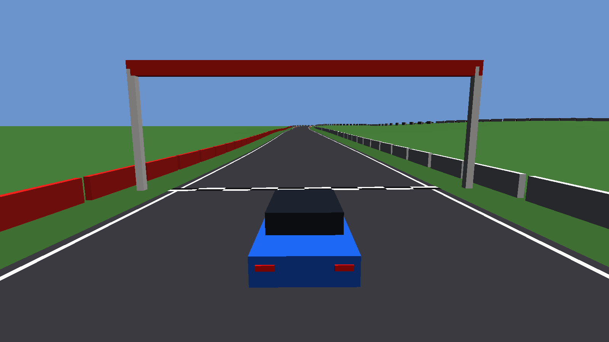

# Car Simulator

An open-source, community-maintained driving simulator built around
**realistic vehicle physics**. It has its **own physics engine** and its **own
Vulkan renderer**: no Jolt, Bullet, PhysX, bgfx, Diligent or Filament. Cars,
karts and (later) rally and road driving are all meant to run on the same
engine, with the differences expressed as data.



> **Status: pre-alpha (0.1.0).** You can drive the test car around a
> procedural circuit with keyboard, gamepad or wheel. Graphics are placeholder
> boxes on purpose: physics comes first (see the [roadmap](docs/ROADMAP.md)).
> Expect things to change and break.

## What is in it today

### Vehicle physics
- **Tyres**: Pacejka Magic Formula 6.x with combined slip, self-aligning,
  overturning and rolling-resistance moments, camber thrust, load dependence,
  `.tir` file parser and scaling factors, transient relaxation, and a bristle
  model for standstill and very low speed.
- **Suspension**: double-wishbone kinematics solved from real hardpoints
  (camber, toe, caster, kingpin, scrub, roll centres, motion ratio), springs,
  asymmetric dampers, progressive bump stops, anti-roll bars and bushings.
- **Powertrain**: engine torque map and friction, crankshaft inertia, friction
  and centrifugal clutches, gearbox with sequential shifting and torque
  converter, open / limited-slip / locked differentials, driveline compliance
  and a turbocharger.
- **Chassis**: mass properties, aerodynamic drag and downforce, Ackermann
  steering with column torque (for force feedback), kart frame torsion.
- **Brakes and driver aids**: disc brakes with a thermal model, brake bias,
  handbrake, and ABS / traction control / stability control.
- **Ground contact**: the wheels raycast the circuit's collision triangle mesh
  (asphalt, kerbs and terrain, indexed by a per-triangle BVH) instead of an
  analytic height field, so a circuit can be real mesh geometry.

### Physics engine
- Double precision, fixed 1 kHz step, deterministic bit for bit on the same
  platform, with snapshot / restore.
- Rigid bodies with an energy-conserving gyroscopic integrator; distance,
  spherical, fixed, revolute and prismatic joints, soft or rigid, with motors
  and limits.
- Collisions: sphere, box, cylinder, convex hulls (GJK/EPA), heightfields and
  triangle meshes; friction, restitution, warm starting, speculative contacts
  against tunnelling, sleeping, sweep-and-prune broadphase.

### Everything else
- **Input**: keyboard, gamepads, wheels and pedals through SDL3, with hot
  plugging, calibration, remapping, saved profiles and a force-feedback
  controller (rumble today; full wheel force feedback is in progress).
- **Mods**: a virtual file system where every mod (folder or `.zip`) is
  mounted over the base content, `mod.toml` manifests with semver dependencies,
  sandboxed Lua scripts and a versioned C API for native plugins.
- **Renderer**: Vulkan 1.3 with dynamic rendering, Slang shaders, debug
  drawing and an off-screen (headless) mode used for automated image tests.
- **Tests**: over 200 test cases check the physics against analytic solutions
  and driving manoeuvres (braking, cornering, crashes, jumps, drifting,
  0-100 km/h).

## Not there yet

Being honest about the gaps helps contributors pick something useful:

- Cars and tracks are described by `car.toml` and `track.toml` and loaded
  through the virtual file system, so a data-only mod can add either, but the
  app does not switch to a loaded car at runtime yet.
- The collision mesh is generated from the track description; there is no
  pipeline for an authored track mesh yet.
- No PBR materials, shadows, real car models, sound, multiplayer or VR yet.
- Some manoeuvre numbers still need tuning against reference data.

## Requirements

- Windows 10/11 or Linux, with a GPU that supports **Vulkan 1.3**.
- To build: **CMake** 3.25+, **Ninja**, **vcpkg** (manifest mode) and a C++20
  compiler: Visual Studio 2022 (v143) or newer, GCC 13+ or Clang 16+.
- The Vulkan SDK is optional (only needed for the validation layers when
  debugging).

## Build and run (Windows)

```powershell
# Once: install vcpkg somewhere stable and point VCPKG_ROOT at it
$env:VCPKG_ROOT = "C:\dev\vcpkg"

# From an "x64 Native Tools Command Prompt for VS"
cmake --preset windows-msvc-release
cmake --build --preset windows-msvc-release
ctest --test-dir build/windows-msvc-release --output-on-failure

# Drive
build\windows-msvc-release\bin\sim.exe --scene drive
```

On Linux use the `linux-gcc-*` or `linux-clang-*` presets. Full instructions,
including the headless GPU tests, are in [docs/BUILDING.md](docs/BUILDING.md).

## Controls

| Action | Key |
|---|---|
| Throttle | `W` / `Up` |
| Brake / reverse | `S` / `Down` |
| Steer | `A` `D` / `Left` `Right` |
| Handbrake | `Space` |
| Reset car | `R` |
| Camera (chase, cockpit, orbit) | `C` |
| Debug overlay (suspension, contacts, tyre forces) | `G` |

Gamepads, wheels and pedals are detected automatically; the controls wizard in
the main menu helps map and calibrate them.

To regenerate the screenshot above with your own GPU, run
`tools\capture_readme_shots.bat`.

## Modding

Drop a folder or `.zip` with a `mod.toml` into `mods/` and enable it in the
mods panel. Files in a mod override base content at the same path. See
[docs/MODS.md](docs/MODS.md), [docs/SCRIPTS.md](docs/SCRIPTS.md) and
[docs/PLUGINS.md](docs/PLUGINS.md).

Only install mods you trust. Lua scripts run in a sandbox, but **native
plugins run with the full permissions of the game**.

## Documentation

- [Roadmap](docs/ROADMAP.md) and [vehicle physics plan](docs/PHYSICS_PLAN.md)
- [Architecture](docs/ARCHITECTURE.md), [conventions](docs/CONVENTIONS.md)
  and [design decisions](docs/DECISIONS.md)
- [Physics engine](docs/PHYSICS.md), [drive scene](docs/DRIVE.md),
  [input](docs/INPUT.md), [rendering](docs/RENDERING.md), [UI](docs/UI.md)
- [Content and licensing](docs/CONTENT.md)
- [Contributing](docs/CONTRIBUTING.md) and [security policy](SECURITY.md)

## Contributing

Contributions are welcome, especially physics validation against real data,
track and car content under free licences, and testing with real wheels. Read
[CONTRIBUTING](docs/CONTRIBUTING.md) first: every commit needs a DCO
sign-off, and all content must be original or freely licensed. Real brands,
cars and tracks are not allowed.

## Privacy

The simulator does not collect telemetry or analytics and makes no network
connections. Logs and settings stay on your computer.

## License

- Code: **GPL-3.0-or-later** with a linking exception for native plugins that
  only use the plugin API (see [LICENSE](LICENSE)).
- Official content in `content/base`: **CC BY-SA 4.0**
  (see [content/base/LICENSE.txt](content/base/LICENSE.txt)).
