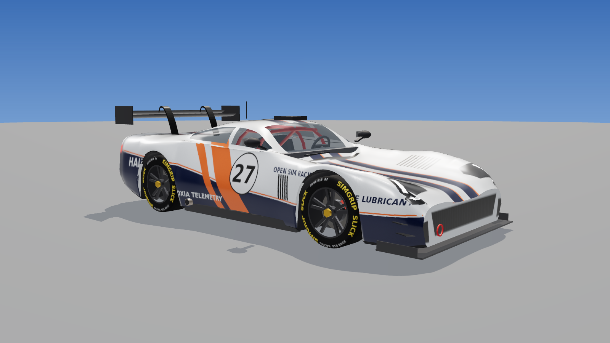

<!-- SPDX-License-Identifier: CC-BY-SA-4.0 -->
# Halvard GT3 (base content)

An original, fictional GT3-class race car. No real manufacturer, brand, logo or
trademarked shape. Licence: CC BY-SA 4.0 (like the rest of `content/base`).
Generated by `tools/asset_gen/car.py` (rebuild with
`python3 tools/asset_gen/car.py <out.glb> <scheme a|b|c> <number>`).



## Files

| File | What |
|---|---|
| `model/car.glb` | glTF 2.0 binary, default livery #27 embedded |
| `model/livery_default.png` | default livery atlas (base colour, 2048x2048) |
| `model/livery_default_emissive.png` | headlights / tail lights mask for the emissive channel |
| `model/livery_template.png` | paint template: the body UV wireframe and the atlas charts |
| `../../skins/.../red_black_8/`, `green_44/` | two extra liveries (same atlas layout) |

## Conventions

- Metres, +Y up, **the car faces -Z**, +X is the car's right, the ground is at y = 0
  (tyre contact patch at rest, no suspension sag).
- Wheelbase 2.70 m (front axle z = -1.38, rear axle z = +1.32), track 1.67 m at the
  wheel centres, length 4.75 m including splitter and wing, width 2.04 m (2.15 m with mirrors),
  height 1.20 m at the roof (1.38 m to the antenna tip).
- Tyres: front radius 0.340 m, width 0.30 m; rear radius 0.355 m, width 0.31 m.

## Node hierarchy

```
car_root                         extras: forward, up, units, wheelbase, name
  body                           paint (livery atlas, clearcoat), black trim, glass
  aero                           splitter, canards, skirts, diffuser, rear wing (carbon) + swan necks
  details                        mirrors, exhausts, tow hooks, roof scoop, antenna, wipers, rain light
  interior                       dash, seat, steering wheel, roll cage (visible through the glass)
  wheel_FL / FR / RL / RR        hub pivot at the wheel centre. Steer the front ones about local Y here.
      wheel_XX_spin              tyre + rim + disc + centre-lock nut. Spin about local X.
      wheel_XX_caliper           brake caliper. Steers with the hub, does not spin.
```

Wheel nodes carry `extras.radius`, `extras.width` and `extras.steered`.

## Materials

`paint_livery` (base colour + emissive textures, `KHR_materials_clearcoat`,
`KHR_materials_emissive_strength`), `glass` (alpha blend), `trim_black`, `carbon`,
`anodised_black`, `mirror_glass`, `cage_red`, `exhaust_metal`, `rain_light`
(emissive), `interior_grey`, `seat_fabric`, `tyre_rubber` (sidewall lettering
texture), `rim_gunmetal`, `wheel_nut`, `brake_disc`, `caliper`.

Brake-light / rain-light intensity should be driven by the game (emissive factor).

## Livery atlas (for skin makers)

The paint uses planar projections, so every chart is a flat "photo" of the car:

| Chart | Atlas area (u, v) | Projection |
|---|---|---|
| Right side | v 0.00-0.25 | side view, front of the car at the right |
| Left side | v 0.25-0.50 | side view, front at the left |
| Top | v 0.50-0.80 | top view, front at the left, car's right side up |
| Front | u 0.0-0.5, v 0.80-1.00 | front view |
| Rear | u 0.5-1.0, v 0.80-1.00 | rear view |

Paint on top of `livery_template.png`. Text reads correctly from outside the car.

## Polygon budget

About 31k triangles in total (body ~20k, each wheel ~2k). LODs are not included
yet; generate them with meshoptimizer at import time.

## Suggested physics data (for `car.toml`)

Plausible GT3-class figures for a fictional car (not copied from any real model):
mass 1300 kg with driver, 48/52 front/rear, CoG height 0.43 m, 405 kW at 6800 rpm,
620 N*m at 5000 rpm, rear-wheel drive, 6-speed sequential, clutch-pack LSD,
ride height 0.075 m front / 0.085 m rear, Cd*A 0.80 m^2, Cl*A -2.4 m^2 at 40/60
front/rear, slick tyres 30/68 R18 front and 31/71 R18 rear, carbon brakes with ABS
and traction control.
