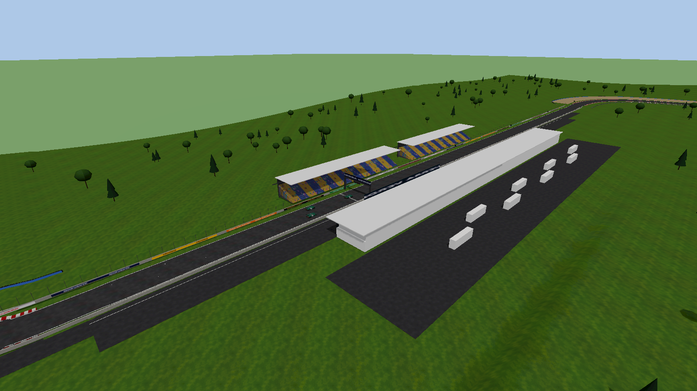

<!-- SPDX-License-Identifier: CC-BY-SA-4.0 -->
# Sierra Verde Circuit (base content)

An original, fictional 2.78 km circuit: a 520 m main straight, a heavy-braking
Turn 1, esses, a long sweeper, a back straight under a footbridge, a tight
hairpin and a flowing infield back to the line. Licence: CC BY-SA 4.0.
Generated by `tools/asset_gen/track.py`.

## Files

| File | What |
|---|---|
| `model/track.glb` | glTF 2.0 binary: visual and collision geometry, PBR textures embedded |
| `track.json` | centreline (x, y, z every ~4 m), width, start line, sectors, grid slots, pit lane, kerb and run-off zones, surface friction table |

## Conventions

- Metres, +Y up. **The start/finish line is at the origin and cars start facing -Z.**
- Driving direction: clockwise seen from above. Pit lane and pit building on the
  +X side of the main straight; grandstands on the -X side.
- Road: 13 m wide, 1.2 % crown, up to 3.5 % banking in corners, 6.8 m of elevation change.

## Nodes and collision

Each node has `extras.collision` (true/false). Every road-type material has
`extras.surface` and `extras.friction`:

| Node | Collision | Surface |
|---|---|---|
| `road` | yes | asphalt (1.00), white lines = paint (0.85) |
| `kerbs` | yes | kerb (0.90), 4.5 cm raised profile |
| `gravel_traps` | yes | gravel (0.45) |
| `runoff` | yes | asphalt_runoff (0.95) |
| `terrain` | yes | grass (0.55) |
| `pit_lane` | yes | asphalt (0.95), concrete pit wall |
| `barriers_armco`, `barriers_tyres`, `barriers_walls` | yes | walls / barriers |
| `pit_building`, `grandstands`, `start_gantry`, `footbridge`, `marshal_posts`, `paddock_trucks` | yes | static scenery |
| `start_finish`, `ad_banners`, `distance_boards`, `trees` | no | decoration |

`start_gantry` has `extras.start_lights` (positions of the 5 start lights) so the
game can light them.

## Contents

Asphalt with a darker rubbered-in racing line (vertex colour), white edge lines,
red/white kerbs in every corner, gravel traps and asphalt run-off, double armco
with posts, tyre walls with conveyor-belt covers, concrete walls and catch fences
on the main straight, a pit lane with pit wall, a 220 m pit building with
numbered garage doors and a glass hospitality level, paddock trucks, two covered grandstands,
a start gantry with lights, a footbridge with banners, 300/200/100 m braking
boards, marshal posts, trackside advertising (invented brands only), about 650
trees and rolling terrain.

## Polygon budget

About 330k triangles; textures 1024x1024 (JPEG colour, PNG for alpha), 17 MB in
total. The terrain is one 5 m grid; the import splits every primitive above 8192
triangles into ~48 m tiles (about 130 for the terrain, the barriers and the
trees), so the renderer can cull them independently.

## In the game

`track.toml` names `model/track.glb` and `track.json`, so the drive scene draws
this circuit instead of the procedural one and the wheels query its triangles:

- **Surface**: every triangle of a node with `extras.collision = true` whose
  material names a surface becomes drivable ground, with that material's
  friction. Roofs, grandstands, the footbridge deck and the trees name no
  surface, so a downward wheel ray never lands on them.
- **Start**: the car spawns on the `start_finish` line at the origin facing -Z,
  settled on the springs at the height of the mesh.
- **Fallback**: outside the mapped surface (a car that leaves the world) the
  analytic circuit derived from `track.json` supports the wheels.

Known limitation: the imported circuit supports the wheels but does not yet
create collision volumes for the barriers and buildings, so the chassis can
pass through a wall. The barriers' geometry and their `extras.collision` flags
are already there for that step.
